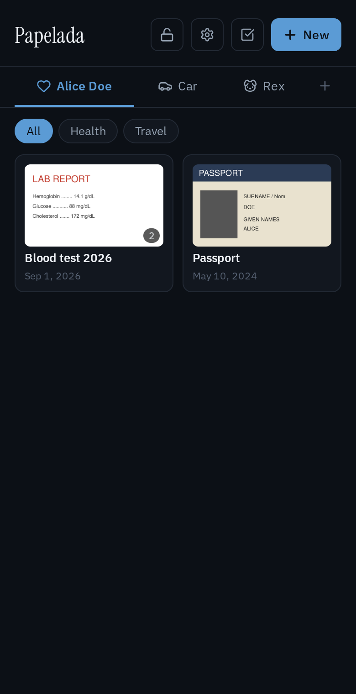
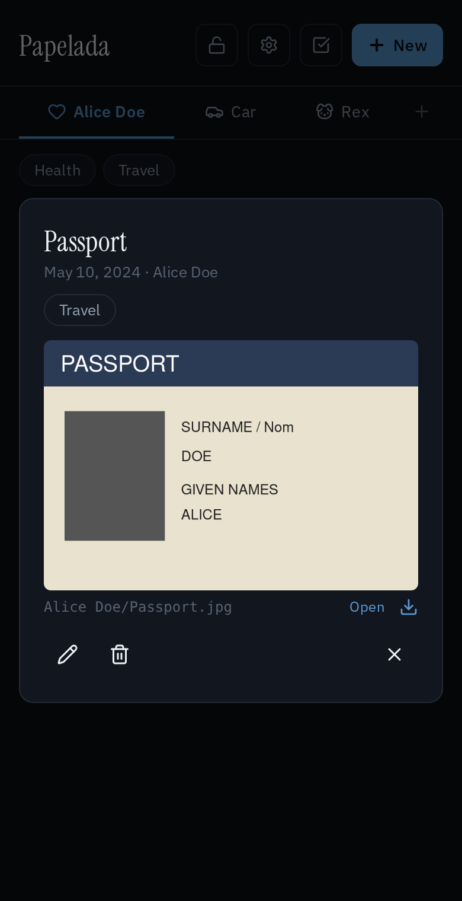
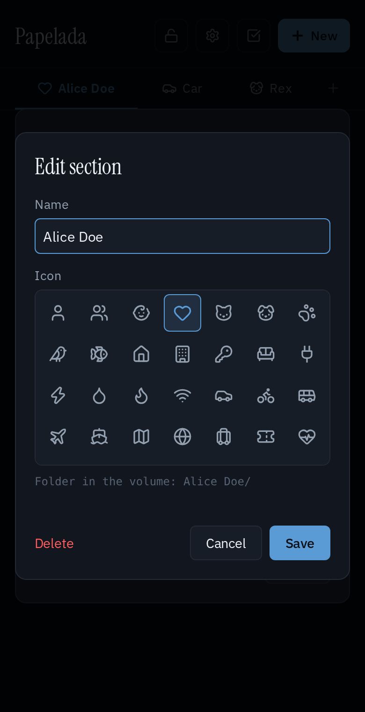

# Papelada

**A self-hosted home for your household's paperwork.**

IDs, exam results, receipts, contracts, vaccination cards: photograph a document with your phone (or
upload any file), file it under a section you created, tag it, and find it again
later.

*Papelada* is Portuguese for "paperwork", or more precisely "a pile of papers".

  
  
  

- **Your own sections**, one per person, pet, car, house, or anything else, each with
  an icon you pick. Reorder, rename and delete them any time.
- **Tags** that work across sections (Health, Taxes, Travel...), to filter documents.
- **Multi-page documents**: take one photo per page, straight from the phone camera,
  or add PDFs and any other file.
- **Crop** a photographed page, with the original kept so the crop can be undone.
- **Plain files you can browse.** The documents volume is an ordinary folder tree with
  readable names, so you can open, copy or back it up without the app.
- **Optional encryption at rest**, switchable any time. The key never lives in the volume.
- **Optional login** for one user, set with two environment variables.
- **Scan** the volume to pick up files and folders you added by hand.
- Six color themes, light and dark.
- **Download** a selection of documents as a zip, laid out like the volume.
- English and Brazilian Portuguese, picked from the browser's language.
- One small container: Python (FastAPI) and a plain JS frontend, no database, no
  build step, no third-party requests (fonts and libraries are bundled), except on the
  API docs page at `/api/docs`, whose Swagger UI loads from a CDN.

## Where to go next

- [Installation](installation.md): Docker Compose, and the settings in `.env`
- [Your documents on disk](storage.md): how the volume is laid out, and scanning files you add by hand
- [Encryption](encryption.md): encrypting the volume, and keeping the key safe
- [Security](security.md): the optional login, and running Papelada outside your home network

## Credits

Icons from [Lucide](https://lucide.dev) (ISC), image cropping by
[Cropper.js](https://github.com/fengyuanchen/cropperjs) (MIT), and the
[IBM Plex Sans](https://github.com/IBM/plex) and
[Instrument Serif](https://github.com/Instrument/instrument-serif) fonts (SIL OFL).
Their licenses are in [`frontend/vendor/`](https://github.com/GusFurtado/papelada/tree/main/frontend/vendor).
